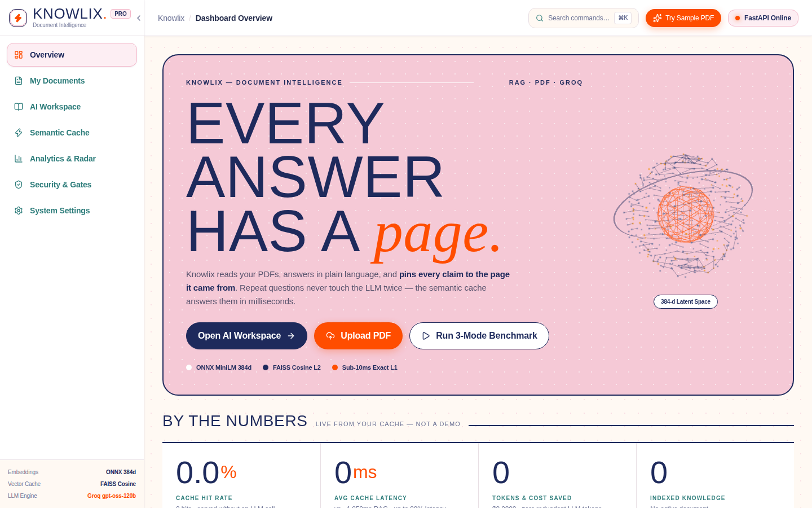
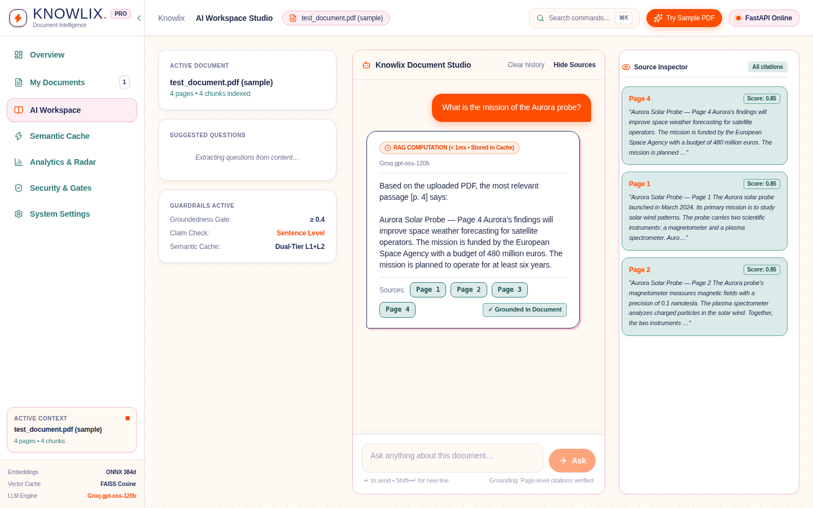

# Knowlix

RAG-based PDF summarizer & Q&A with Document-Aware Semantic Caching — upload a PDF, ask questions, get answers
grounded in the document with page citations, with semantically equivalent questions cached instantly.

🌐 **Live demo:** https://pdf-analyzer-vercel.vercel.app/

## Screenshots




- **Frontend** (`frontend/`): Next.js 14 app — upload, analyze, ask, with
  per-answer Support / Sources / Retrieval lines, refusal explanations, cache badges (Exact Hit, Semantic Hit, RAG Miss),
  expandable performance telemetry panels, and a dedicated **Semantic Cache & Analytics Dashboard** with 3-mode live benchmarking.
  Deploys on Vercel (free Hobby tier).
- **Backend** (`backend/`): FastAPI service — page-aware chunking, ONNX
  embeddings (all-MiniLM-L6-v2, same model as the original, no torch),
  FAISS hybrid retrieval with reciprocal rank fusion, groundedness guardrails
  (relevance gate, `[p. N]` citations, sentence-level claim check,
  prompt-injection sanitizer, 20 MB / 500-page caps), Groq LLM
  (`openai/gpt-oss-120b`) with an extractive fallback when no key is set,
  and the **Knowlix Document-Aware Semantic Cache Engine** (dedicated FAISS `IndexFlatIP` index,
  Redis/LRU tiered cache, intent safeguard filters, document isolation, real-time metrics).
  Deploys on Render free tier (512 MB) via `backend/Dockerfile`.
- **Docs**: `DEPLOY.md` (Vercel + Render steps, env vars), `backend/README.md`,
  `frontend/README.md`, `SEMANTIC_CACHE_INTEGRATION_PLAN.md`, `DEVELOPMENT_STATUS.md`.

## Run locally

```bash
# backend (Python 3.11 / 3.12)
cd backend
python -m venv .venv && source .venv/bin/activate
pip install -r requirements.txt
cp .env.example .env   # set GROQ_API_KEY for LLM answers (optional)
uvicorn app.main:app --host 0.0.0.0 --port 8000
pytest -v              # 52 tests (core, api, semantic cache)

# frontend (Node 20+)
cd frontend
npm install
npm run dev            # http://localhost:3000
npm run build          # production build
```

The backend needs no API key to run: without `GROQ_API_KEY` it answers
from the retrieved passages (extractive mode). The embedding model is
bundled in `backend/app/onnx_model/` — nothing is downloaded at runtime.

## Origin

Rebuilt from the Streamlit app in
[Numanahmad12/pdf_analyzer](https://github.com/Numanahmad12/pdf_analyzer)
(same retrieval and guardrail logic, same test cases) as a split
Next.js + FastAPI app with document-aware semantic caching.
